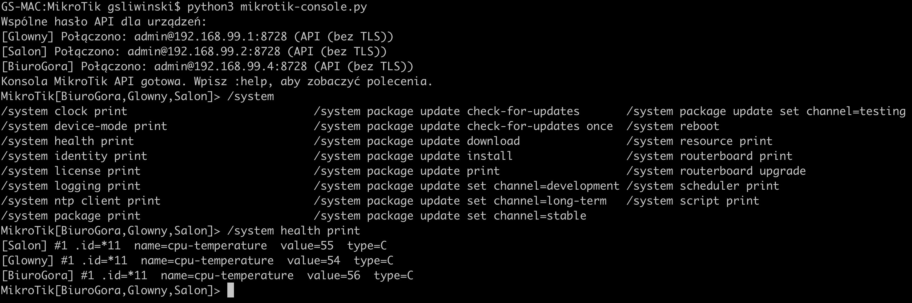

# Wspólna konsola API MikroTik

[English](README.md) | **Polski**

**Aktualna wersja: 1.6.1** (wartość z pliku `VERSION`).

Program łączy się równolegle z wieloma routerami przez natywne RouterOS API. Utrzymuje osobne połączenie API do każdego routera, wykonuje polecenia równolegle i pokazuje odpowiedzi jako rekordy oznaczone nazwą urządzenia.

Każdy MikroTik musi mieć skonfigurowany i osiągalny adres IP — IPv4 albo IPv6. RouterOS API działa przez TCP/IP, dlatego urządzeń bez adresu IP nie można obsłużyć tą aplikacją.

## Informacje o projekcie

- Język implementacji: **Python**; odczyt interfejsów Windows wywołuje również PowerShell.
- Języki dokumentacji i komunikatów aplikacji: angielski i polski.
- Licencja: **GNU GPL v3**, zgodnie z plikiem [LICENSE](LICENSE).
- Zależności: biblioteka standardowa dla podstawowych funkcji; opcjonalne podpowiedzi Tab na Windows korzystają z `pyreadline3`. Instalacja na Windows: `py -m pip install -r requirements.txt`.
- Testy automatyczne: GitHub Actions uruchamia testy jednostkowe na Linux, Windows i macOS z Pythonem 3.12 i 3.14. Jest to skonfigurowana macierz testów, a nie potwierdzenie działania w rzeczywistej sieci routerów.
- Współpraca: [CONTRIBUTING.md](CONTRIBUTING.md). Zgłaszanie problemów bezpieczeństwa: [SECURITY.md](SECURITY.md).

## Wymagania dotyczące Pythona i systemu operacyjnego

Minimalna wersja Pythona wynikająca z kodu to **3.9**: konsola używa `asyncio.to_thread()`, dostępnego od 3.9. Do nowej instalacji zalecany jest **Python 3.12 lub nowszy**, z nadal wspieranej gałęzi. Aktualne testy automatyczne uruchomiono na **CPython 3.12.14 w macOS**; nie oznacza to przetestowania wszystkich wersji Pythona i systemów.

Skrypty korzystają z biblioteki standardowej Pythona. W macOS i Linux z pełną instalacją Pythona nie trzeba wykonywać `pip install`. Pliki `mikrotik-console.py`, `mikrotik-config-builder.py` i `mikrotik_language.py` muszą znajdować się w jednym katalogu. Konsola potrzebuje też `devices.json`, przygotowanego ręcznie lub przez generator. Polecenia uruchamiaj z tego katalogu w interaktywnym terminalu.

| System | Instalacja Pythona | Aktualne ograniczenia aplikacji |
|---|---|---|
| macOS, Intel lub Apple Silicon | Python 3.12+ z python.org albo Homebrew; uruchamianie przez `python3` | Główna platforma rozwoju i testów. Podpowiedzi Tab korzystają z opcjonalnego modułu `readline`, opartego na GNU readline lub libedit; konsola działa również bez niego. |
| Windows 11 | Python 3.12+ z python.org; uruchamianie przez `py -3` | Skanowanie podanego prefiksu IPv4/IPv6 używa przenośnych API Pythona, ale nie zostało tu przetestowane na Windows. Konsola działa bez `readline`, ale wtedy podpowiedzi Tab są niedostępne. Natywne połączenia API na Windows nie zostały tu przetestowane. Automatyczne wykrywanie MNDP nie zostało zweryfikowane na Windows. |
| Linux, w tym Ubuntu 26.04 LTS | Python 3.12+ z dystrybucji; Ubuntu 26.04 dostarcza Python 3.14 w pakiecie `python3` | Podpowiedzi Tab wymagają `readline`; moduł jest opcjonalny przy uruchamianiu konsoli. Skanowanie podanego prefiksu używa przenośnych API, ale nie zostało tu przetestowane na Linux. Etap automatycznego MNDP przez IPv4 broadcast korzysta z parsowania `ifconfig` właściwego dla macOS i wymaga dostosowania do Linux; etap IPv6 multicast jest osobny. |

### macOS

Zainstaluj wspieraną wersję Pythona 3.12+ z [python.org](https://www.python.org/downloads/macos/) albo użyj Homebrew, jeśli masz je już zainstalowane:

```sh
brew install python
python3 --version
python3 -c "import asyncio, ssl, readline; print('Python modules OK')"
python3 mikrotik-config-builder.py --ipv6 --lang pl
python3 mikrotik-console.py --lang pl
```

Nie zakładaj, że Python dostarczony przez Apple lub narzędzia programistyczne spełnia wymagania: sprawdź interpreter rzeczywiście uruchamiany poleceniem `python3`.

### Windows 11

Zainstaluj Python z [oficjalnej strony dla Windows](https://www.python.org/downloads/windows/). Korzystając z Python install manager, zainstaluj interpreter i sprawdź go w PowerShell:

```powershell
py install 3.14
py -3 --version
py -3 mikrotik-config-builder.py --network 192.168.99.0/24 --lang pl
```

`py install` dotyczy nowego Python install manager. Jeśli używasz tradycyjnego instalatora, wybierz Python 3.12+ i sprawdź go przez `py -3 --version`.

Od wersji 1.5.3 moduł `readline` jest opcjonalny. Standardowy Python Windows może uruchomić konsolę bez instalowania dodatkowych pakietów; bez `readline` podpowiedzi Tab są niedostępne. Aby je włączyć lub usunąć błąd `ModuleNotFoundError: No module named 'readline'` w starszych wersjach, wykonaj [instrukcję instalacji dla Windows poniżej](#instalacja-podpowiedzi-tab-na-windows).

```powershell
py -3 .\mikrotik-console.py --lang pl
```

WSL nie jest równoważny natywnemu Windows przy wykrywaniu MNDP w lokalnym segmencie; jego konfigurację sieci trzeba sprawdzić osobno.

### Wykrywanie IPv6 na Windows

Od 1.6.0, jeśli MNDP nie zwróci żadnych adresów na Windows, generator sprawdza API w lokalnych podsieciach IPv4, z uwzględnieniem `--max-hosts`. Po zalogowaniu odczytuje `/ipv6/address/print` i `/ip/neighbor/print`, a następnie sprawdza połączenie API z adresami IPv6 przed zapisaniem ich do konfiguracji. Tymczasowe adresy IPv4 nie trafiają do wyniku trybu IPv6. Wymaga to uprawnień do odczytu przez API oraz osiągalnych adresów API IPv6. Duże podsieci przekraczające pozostały limit są pomijane z komunikatem. Lokalny adres IPv6 komputera nie potwierdza odbioru pakietów MNDP.

Od 1.5.5 automatyczne wykrywanie odczytuje interfejsy IPv4 broadcast przez PowerShell i używa liczbowych identyfikatorów zakresu IPv6 na Windows (np. `fe80::1%12`). Sprawdzono to na symulowanych danych interfejsów, a nie w sieci Windows. Jeśli wykrywanie nie zwraca adresów, sprawdź IPv6 na aktywnej karcie, połączenie z lokalnym segmentem, MNDP na routerach oraz zgodę Zapory Windows na odbiór przez Python ruchu UDP/5678 w zaufanej sieci lokalnej. Jeśli WinBox korzysta z portu wykrywania, zamknij go i ponów próbę. MNDP można ominąć, podając `--ipv6 --network` z małym, osiągalnym prefiksem. Brak odpowiedzi MNDP nie oznacza, że API routera jest niedostępne.

### Instalacja podpowiedzi Tab na Windows

Windows nie zawiera uniksowego modułu `readline`. Zainstaluj zamiennik dla Windows — [pyreadline3](https://pypi.org/project/pyreadline3/), który udostępnia zgodny moduł `readline`. W PowerShell użyj tego samego Pythona do instalacji i uruchamiania:

```powershell
py -m pip install --upgrade pyreadline3
py -c "import readline; print(readline.__file__)"
py .\mikrotik-console.py --lang pl
```

Jeśli brakuje `pip`, wykonaj `py -m ensurepip --upgrade` i ponów instalację. Jeśli wybierasz konkretny interpreter, stosuj ten sam wybór w każdym poleceniu, np. `py -3.14 -m pip install --upgrade pyreadline3` i `py -3.14 .\mikrotik-console.py`. W środowisku wirtualnym używaj jego poleceń `python -m pip` i `python`. Po instalacji uruchom konsolę ponownie.

Bez modułu konsola pokazuje wskazówkę instalacji i działa bez podpowiedzi Tab. Nie instaluj starego pakietu `pyreadline`. Zamiennik nie został tu przetestowany na Windows 11; podane polecenie sprawdza, czy Twój interpreter potrafi go zaimportować.

### Ubuntu 26.04 LTS

Zainstaluj Python z repozytorium dystrybucji bez zastępowania systemowego interpretera:

```sh
sudo apt update
sudo apt install python3
python3 --version
python3 -c "import asyncio, ssl, readline; print('Python modules OK')"
python3 mikrotik-config-builder.py --network 192.168.99.0/24 --lang pl
python3 mikrotik-console.py --lang pl
```

Do uruchomienia tej wersji nie są wymagane `pip`, `python3-dev` ani środowisko wirtualne. Sama instalacja `net-tools` nie naprawia etapu MNDP przez IPv4: kod oczekuje także formatu wyjścia macOS. Do czasu dostosowania tego etapu na Linux używaj jawnie podanego, osiągalnego prefiksu.

Na każdym systemie komputer musi mieć dostęp do portu TCP API routerów (8728 albo 8729). Automatyczne wykrywanie wymaga dodatkowo ruchu UDP/5678 w lokalnym segmencie i włączonego IPv6. Sama aplikacja nie wymaga uprawnień administratora/root; mogą być potrzebne do instalacji pakietów systemowych.

Źródła: [dokumentacja asyncio](https://docs.python.org/3.12/library/asyncio-task.html#asyncio.to_thread), [dostępność readline](https://docs.python.org/3.12/library/readline.html), [pakiet python3 w Ubuntu 26.04](https://packages.ubuntu.com/resolute/python3).

## Przykładowy ekran



## Konfiguracja routerów

Domyślna konfiguracja programu korzysta z nieszyfrowanego API na porcie TCP 8728. Na każdym routerze włącz usługę `api` i ogranicz dostęp do adresu komputera z aplikacją, na przykład:

```routeros
/ip service set api disabled=no address=192.168.88.10/32
```

Ogranicz dostęp także regułami firewalla. Użyj konta RouterOS z uprawnieniem `api` i tylko tymi pozostałymi uprawnieniami, których wymagają wykonywane polecenia. **Nieszyfrowane API przesyła hasło i polecenia jawnym tekstem**, więc używaj go wyłącznie w zaufanej sieci lokalnej lub przez VPN. RouterOS domyślnie używa portów 8728 dla API i 8729 dla API-SSL ([dokumentacja MikroTik](https://help.mikrotik.com/docs/spaces/ROS/pages/47579160/API)).

## Hasła

W `devices.json` wspólne ustawienia znajdują się w sekcji `defaults`; wpisy w `devices` zawierają zwykle tylko nazwę i adres routera. Ustawienia konkretnego urządzenia można nadpisać w jego wpisie. Tryb hasła ustaw w `defaults`:

- `"password_mode": "shared"` pyta raz o wspólne hasło dla routerów bez własnego ustawienia.
- `"password_mode": "individual"` pyta osobno dla każdego takiego routera.
- Wpis `"password_mode": "individual"` wewnątrz konkretnego urządzenia wymusza osobne hasło dla niego, nawet gdy trybem domyślnym jest `shared`.

Hasła są pobierane przy uruchomieniu i nie są zapisywane do pliku. Zobacz [devices.example.json](devices.example.json).

## Język komunikatów

Oba skrypty automatycznie wybierają język komunikatów, pytań, błędów i pomocy. Polski jest używany, gdy wykryty język systemu to polski; w pozostałych przypadkach, również przy nieudanym wykrywaniu, używany jest angielski. macOS: pierwszy język z `AppleLanguages`; Windows: język interfejsu użytkownika; Linux: ustawienia `LC_ALL`, `LANGUAGE`, `LC_MESSAGES` i `LANG`, w tej kolejności. Wspólny moduł `mikrotik_language.py` musi znajdować się obok skryptów. Odpowiedzi RouterOS i komunikaty błędów pochodzące z systemu są wyświetlane w oryginale.

Możesz wymusić język w obu programach przez `--lang pl` albo `--lang en`. Opcja ma pierwszeństwo przed ustawieniami systemu i zmienia również język pomocy `--help`. Bez `--lang` język jest wykrywany automatycznie.

```sh
python3 mikrotik-config-builder.py --ipv6 --lang en
python3 mikrotik-console.py --lang pl
```

## Automatyczne wykrywanie urządzeń

`mikrotik-config-builder.py` skanuje podsieć przez port API, loguje się do odpowiadających routerów i pobiera ich nazwy z `/system identity`. Do wykrycia urządzenia potrzebne jest dostępne API oraz poprawny wspólny login i hasło. Hasło jest pytane w terminalu i nie trafia do pliku.

```sh
python3 mikrotik-config-builder.py --network 10.0.138.0/24
```

Program domyślnie używa nieszyfrowanego API na porcie 8728 i zapisuje wynik do `devices.json`. Jeśli plik już istnieje, zapyta przed zastąpieniem. Można wskazać inną podsieć, port, użytkownika i plik wynikowy, np. `--network 10.0.137.0/24 --output nowa-siec.json`. Dla API-SSL użyj `--ssl --port 8729`; certyfikat jest weryfikowany domyślnie. `--insecure` wyłącza tę weryfikację i należy go używać tylko świadomie.

W trybie `--ipv6` program wysyła zapytania MNDP UDP/5678 przez IPv4 broadcast (ogólny i skierowany na każdy lokalny interfejs) oraz IPv6 multicast. Czeka 35 sekund, uwzględniając domyślny, 30-sekundowy cykl ogłoszeń RouterOS. Z ogłoszeń pobiera adresy IPv6, a adresy IPv4 wykorzystuje dodatkowo jako tymczasowy punkt połączenia do odczytania `/ip/neighbor/print`. Następnie próbuje po IPv6 dotrzeć do sąsiadów widocznych routerom, także gdy komputer nie odebrał ich ogłoszeń bezpośrednio. Tymczasowe adresy IPv4 nie trafiają do `devices.json`; wynik zawiera adresy IPv6.

Wykrywanie korzysta z MNDP i tablic sąsiadów RouterOS, a nie ogólnej tablicy sąsiadów macOS, która może zawierać inne urządzenia i interfejsy systemowe. Nie wymaga podawania podsieci. Po wykryciu program próbuje zalogować się do API; hasło musi być prawidłowe, a usługa API dostępna. Dla IPv4 builder wyświetla jedynie liczbę nieudanych prób, bez listy poszczególnych adresów. Dla IPv6 nadal pokazuje osobny błąd dla każdego hosta.

Adresy link-local `fe80::` działają tylko w segmencie, w którym zostały wykryte. Program zapisuje w `host` również identyfikator interfejsu komputera, np. `fe80::2ec8:1bff:fe05:2a4e%en0`; konsola używa go przy połączeniu przez IPv6. Wykrywanie obejmuje lokalne łącza komputera i nie przechodzi przez routery do innych VLAN-ów ani podsieci. Adresy z tabel sąsiadów są używane tylko pochodząc z odpowiedzi routerów MikroTik.

```sh
python3 mikrotik-config-builder.py --ipv6
```

Można też podać ograniczony, osiągalny prefiks IPv6 przez `--network`, aby sprawdzić go po kolei:

```sh
python3 mikrotik-config-builder.py --ipv6 --network fd12:3456:789a::/120 --max-hosts 256
```

Skaner respektuje limit `--max-hosts` (domyślnie 4096). Nie skanuj całego typowego prefiksu `/64`; ma zbyt wiele adresów. Router musi mieć włączone API, a reguły `/ip service` i IPv6 firewall muszą dopuszczać połączenie z komputera uruchamiającego skaner.

Program od razu wyświetla komunikat przygotowania, a przed wykrywaniem MNDP informuje o oczekiwaniu na ogłoszenia.

Nazwa urządzenia pochodzi z RouterOS Identity. Dla każdej nazwy generator zapisuje tylko jeden działający adres: pierwszy w kolejności adresów IP. Pozostałe adresy tej samej nazwy są pomijane, bez dodawania fragmentu IP do nazwy, dzięki czemu konsola łączy się z urządzeniem tylko raz. Routery o tej samej Identity są traktowane jako jedno urządzenie; osobne routery powinny mieć różne nazwy.

## Uruchomienie

```sh
cp devices.example.json devices.json
```

`devices.example.json` zawiera przykładowe 28 urządzeń `S01R1`–`S14R2` z adresami `10.0.138.1`–`10.0.138.28` i wspólnymi ustawieniami w `defaults`. Przed użyciem dostosuj nazwy i adresy do swojej sieci, po czym uruchom:

```sh
python3 mikrotik-console.py
```

## Parametry programów

### `mikrotik-console.py`

```sh
python3 mikrotik-console.py [--config PLIK_JSON] [--lang pl|en]
```

| Parametr | Domyślna wartość | Opis |
|---|---|---|
| `-h`, `--help` | — | Wyświetla pomoc i kończy działanie. |
| `--lang pl`, `--lang en` | automatyczne wykrywanie | Wymusza polskie lub angielskie komunikaty i pomoc. |
| `-c PLIK_JSON`, `--config PLIK_JSON` | `devices.json` | Wskazuje plik konfiguracji urządzeń. |
| `--password-prompt` | wyłączony | Ukryty, zgodnościowy przełącznik; hasła i tak są pobierane interaktywnie według `password_mode` w konfiguracji. |

#### Pola pliku `devices.json`

Konfiguracja zawiera sekcję `defaults` ze wspólnymi ustawieniami oraz tablicę `devices` z urządzeniami. Pola urządzenia mogą nadpisać odpowiadające im wartości domyślne.

| Pole | Domyślna wartość | Opis |
|---|---|---|
| `defaults` | `{}` | Wspólne ustawienia urządzeń; każde pole można nadpisać w konkretnym wpisie. |
| `devices` | wymagane | Niepusta tablica urządzeń. |
| `name` | wymagane | Nazwa urządzenia używana w konsoli; musi być unikalna. |
| `host` | wymagane | Osiągalny adres IPv4 lub IPv6 routera. |
| `username` | `admin` | Nazwa użytkownika API. |
| `port` | `8728` bez TLS, `8729` z TLS | Port TCP API; jawnie podana wartość zastępuje port wynikający z `ssl`. |
| `ssl` | `false` | `true` włącza API-SSL, `false` używa nieszyfrowanego API. |
| `verify_ssl` | `true` | Weryfikuje certyfikat API-SSL. Ma znaczenie, gdy `ssl` jest włączone. |
| `password_mode` | `shared` | `shared` pyta raz o wspólne hasło, a `individual` pyta osobno dla każdego urządzenia. Wpis urządzenia może nadpisać tryb z `defaults`. |

Starsze pliki mogą ustawiać `password_mode` na najwyższym poziomie JSON; nowe konfiguracje powinny umieszczać go w `defaults`.

### `mikrotik-config-builder.py`

```sh
python3 mikrotik-config-builder.py [PARAMETRY]
```

| Parametr | Domyślna wartość | Opis |
|---|---|---|
| `-h`, `--help` | — | Wyświetla pomoc i kończy działanie. |
| `--lang pl`, `--lang en` | automatyczne wykrywanie | Wymusza polskie lub angielskie komunikaty i pomoc. |
| `--network CIDR` | `10.0.138.0/24` bez `--ipv6`; brak przy automatycznym wykrywaniu IPv6 | Prefiks skanowany po kolei. Z `--ipv6` pominięcie tej opcji aktywnie wykrywa urządzenia przez MNDP. |
| `--ipv6` | wyłączony | Używa IPv6. Bez `--network` wysyła zapytania MNDP przez IPv4 broadcast i IPv6 multicast, a następnie uzupełnia wykrywanie z tabel `/ip/neighbor` dostępnych routerów. Z `--network` skanuje podany prefiks. |
| `--username NAZWA` | `admin` | Wspólna nazwa użytkownika API używana do logowania i zapisana w sekcji `defaults`. Hasło jest pytane w terminalu. |
| `--port PORT` | `8728` | Port TCP API skanowanych routerów. Przy `--ssl` podaj port API-SSL, zwykle `8729`. |
| `--ssl` | wyłączony | Używa API-SSL zamiast nieszyfrowanego API. |
| `--insecure` | wyłączony | Wyłącza weryfikację certyfikatu; działa tylko z `--ssl`. |
| `--timeout SEKUNDY` | `1.5` | Maksymalny czas próby połączenia z jednym adresem. |
| `--workers LICZBA` | `48` | Maksymalna liczba równoległych prób połączenia. |
| `--max-hosts LICZBA` | `4096` | Limit liczby adresów do sprawdzenia w podanej podsieci. |
| `--output PLIK` | `devices.json` | Ścieżka pliku JSON, do którego zostanie zapisana konfiguracja. |
| `--force` | wyłączony | Zastępuje istniejący plik wynikowy bez pytania. Bez tego przełącznika program pyta o zgodę w terminalu. |

Przykład skanowania innej podsieci IPv4 z API-SSL i zapisem do osobnego pliku:

```sh
python3 mikrotik-config-builder.py --network 192.168.88.0/24 --ssl --port 8729 --output routers.json
```

## Obsługa konsoli

- Wpisz polecenie RouterOS, aby wysłać je równolegle do wybranych urządzeń, np. `/system identity print`.
- Ścieżki można wpisać ze spacjami albo ukośnikami, np. `/system package update check-for-updates` lub `/system/package/update/check-for-updates`.
- Tab podpowiada też aktualizację RouterOS: `/system package print`, sprawdzenie aktualizacji, pobranie, wybór kanału oraz instalację. `download` pokazuje zbiorczy postęp zamiast wypisywać każdy fragment pobierania. `install` pobiera i instaluje aktualizację, po czym router uruchamia się ponownie. Przed instalacją wybierz router przez `:only nazwa`, aby nie zrestartować wszystkich wybranych urządzeń naraz.
- `:list` pokazuje urządzenia i ich stan.
- `:only router-dom,router-biuro` wybiera urządzenia docelowe.
- `:all` wybiera wszystkie połączone urządzenia.
- `:reconnect` zamyka stare sesje i próbuje połączyć ponownie ze wszystkimi routerami z konfiguracji; niedostępne urządzenia można ponowić kolejnym `:reconnect`.
- `/system reboot`, `/system routerboard upgrade` oraz `/system/reset-configuration` są podpowiadane przez Tab. Reset konfiguracji kasuje ustawienia routera i może zerwać połączenie; przed poleceniem wybierz pojedyncze urządzenie przez `:only nazwa`.
- `Tab` podpowiada typowe ścieżki z głównych gałęzi IP, SYSTEM i TOOLS oraz komendy konsoli.
- Tab podpowiada również `/system routerboard upgrade` do aktualizacji RouterBOOT, `/system reboot` do restartu oraz `/system/reset-configuration` do resetu konfiguracji. Po restarcie użyj `:reconnect`, aby ponownie połączyć się bez zamykania aplikacji.
- Podpowiedzi `/tool romon print` i `/tool romon set enabled=yes` pokazują stan i włączają RoMON na wybranym urządzeniu.
- `:help` pokazuje pomoc, a `:quit` zamyka połączenia.

Konsola przekazuje komendy do API bez zamkniętej listy RouterOS akcji, więc może obsługiwać komendy dostępne w danej wersji RouterOS i jej pakietach, o ile są dostępne przez API. Polecenia można podać jako ścieżkę CLI ze spacjami albo API ze znakami `/`; po `print` można użyć API query, np. `/ip/address/print ?address=192.168.99.1/24`. Typowe warunki CLI po `where` są tłumaczone na zapytania API. Każdy rekord mieści atrybuty w jednym wierszu, zawijanym do szerokości terminala. API nie jest terminalem tekstowym: nie przekazuje ANSI-owego paska postępu ani interaktywnych pytań. Podpowiadanie Tab korzysta z listy przykładowych poleceń w programie; nie pobiera dynamicznych podpowiedzi z routera.

Tylko końcowe statusy polecenia `/system package update check-for-updates` są kolorowane w terminalu: „System is already up to date” na zielono, inne końcowe statusy na czerwono. Status pośredni „finding out latest version...” oraz odpowiedzi pozostałych komend pozostają w domyślnym kolorze terminala. Kolory są wyłączone przy przekierowaniu wyjścia oraz po ustawieniu `NO_COLOR`.

## Techniczne aspekty działania

### Komponenty i kolejność działania

| Komponent | Odpowiedzialność |
|---|---|
| `mikrotik-config-builder.py` | Wykrywanie adresów, sprawdzanie dostępu API, odczyt nazw RouterOS i generowanie `devices.json`. |
| `mikrotik-console.py` | Odczyt konfiguracji, utrzymywanie sesji TCP dla urządzeń, tłumaczenie poleceń i prezentacja odpowiedzi. |
| `mikrotik_language.py` | Wykrywanie języka systemu i zastosowanie `--lang pl/en` przed przygotowaniem pomocy. |

Generator jest osobnym etapem przygotowania. Konsola odczytuje zapisany plik i nie uruchamia automatycznie wykrywania. Oba programy korzystają z `asyncio` do operacji sieciowych. Odczyt poleceń konsoli używa `asyncio.to_thread(input, ...)`, aby nie blokować pętli zdarzeń. Zbieranie MNDP i odczyt interfejsów w generatorze są synchroniczne i kończą się przed skanowaniem API.

### Transport RouterOS API

Skrypty implementują protokół RouterOS API bez zewnętrznej biblioteki klienta. Żądanie jest zdaniem złożonym ze słów UTF-8. Każde słowo poprzedza długość w bajtach, kodowana w jednym do pięciu bajtów; słowo o zerowej długości kończy zdanie. Logowanie wysyła `/login` z atrybutami `=name=` i `=password=`. Nie zaimplementowano starszego mechanizmu logowania challenge-response.

Typy odpowiedzi obejmują `!re` (rekord), `!done` (zakończenie), `!trap` (błąd polecenia) i `!fatal` (błąd krytyczny). Atrybuty są odczytywane ze słów `=key=value`. Po `!trap` konsola odczytuje zakończenie, aby zachować synchronizację strumienia; powtarzające się komunikaty błędów łączy przy wyświetlaniu. TCP łączy się bezpośrednio ze wskazanym adresem IPv4/IPv6. TLS korzysta z modułu `ssl`; weryfikacja certyfikatu jest włączona, jeśli nie została jawnie wyłączona.

### Wykrywanie i sprawdzanie adresów

1. Przy jawnym `--network` generator wylicza adresy hostów z prefiksu CIDR. Przed wyliczeniem sprawdza liczbę adresów względem `--max-hosts`. Prefiks `/128` z zakresem, np. `fe80::4aa9:8aff:feb7:5699%12/128`, sprawdza jeden adres IPv6 bez MNDP.
2. Automatyczne `--ipv6` zbiera ogłoszenia MNDP i wysyła żądania odświeżenia przez UDP/5678. Etap IPv6 dołącza do `ff02::1` na lokalnych interfejsach, czeka 35 sekund i ponawia żądania. Etap IPv4 wysyła broadcast ogólny i skierowany na każdym wykrytym interfejsie IPv4.
3. Parser MNDP odczytuje czterobajtowy nagłówek i pola typu/długości/wartości w kolejności big-endian. Wymaga pola adresu MAC i odczytuje pola adresów IPv4/IPv6. Nie skanuje ogólnej pamięci sąsiadów ARP/NDP systemu.
4. Gdy Windows nie otrzyma żadnych adresów przez MNDP, generator odczytuje lokalne prefiksy IPv4 przez PowerShell i używa ich do wstępnych połączeń API. Zbyt duże prefiksy są pomijane. Ta ścieżka nie uruchamia się tylko dlatego, że część adresów znalezionych przez MNDP później nie odpowiada przez API.
5. Każdy adres przechodzi połączenie TCP, logowanie API i odczyt `/system/identity/print`. W trybie automatycznym `/ip/neighbor/print` może dostarczyć kolejnych adresów IPv6. Dla wstępnych połączeń IPv4 ze znanym interfejsem lokalnym `/ipv6/address/print` dostarcza także własnych, włączonych i poprawnych adresów IPv6 routera. Przed zapisem te adresy są osobno sprawdzane przez API.

Adresy link-local IPv6 zachowują zakres interfejsu komputera: np. `%en7` na macOS lub `%12` na Windows. Nazwa interfejsu RouterOS nie zastępuje zakresu komputera. Takie adresy w `devices.json` są właściwe dla konkretnego komputera; przeniesienie pliku może wymagać zmiany zakresów.

Generator zapamiętuje sprawdzone adresy pomiędzy rundami wykrywania. Semafor ogranicza liczbę równoczesnych prób przez `--workers` (domyślnie 48). `--timeout` (domyślnie 1,5 sekundy) obowiązuje osobno dla połączenia i etapów odbioru odpowiedzi, a nie dla całego skanowania. `--max-hosts` (domyślnie 4096) ogranicza łączną liczbę sprawdzanych adresów, w tym wstępnych IPv4 i późniejszych IPv6; osiągnięcie limitu może zatrzymać dalsze wykrywanie.

### Zapis konfiguracji i duplikaty

Do wyniku kwalifikują się tylko poprawne odpowiedzi API. Automatyczny tryb IPv6 wyklucza tymczasowe adresy IPv4. Wyniki są sortowane według adresu i zakresu; generator zachowuje pierwszy działający adres dla każdej dokładnej nazwy RouterOS Identity, z uwzględnieniem wielkości liter. Kluczem deduplikacji jest nazwa, a nie MAC czy numer seryjny: osobne routery z taką samą nazwą są traktowane jako jedno urządzenie.

Generator zapisuje JSON do sąsiedniego pliku `.tmp`, a po zapisie zastępuje plik docelowy. Chroni to przed zastąpieniem konfiguracji częściowo zapisanym JSON-em, ale nie gwarantuje trwałości przy utracie zasilania. Jeśli nie znaleziono urządzeń kwalifikujących się do zapisu, poprzednia konfiguracja pozostaje zachowana. Hasła pozostają w pamięci procesu i nie trafiają do JSON. Błędy IPv4 są podsumowywane; błędy IPv6 są wyświetlane osobno dla każdego adresu.

### Współbieżność konsoli i obsługa poleceń

Konsola łączy się równolegle z urządzeniami i utrzymuje osobne obiekty odczytu, zapisu oraz `asyncio.Lock` dla każdego routera. Polecenia dla wybranych urządzeń wykonuje przez `asyncio.gather`; blokada danego urządzenia zapobiega mieszaniu odpowiedzi różnych poleceń w jednej sesji. Odpowiedzi trafiają do `asyncio.Queue`, a osobne zadanie drukuje je na bieżąco. Nie ma transakcji obejmującej wiele routerów ani wycofywania zmian: jedno urządzenie może wykonać polecenie, gdy inne zgłosi błąd.

Połączenie i logowanie mają osobne limity 12 sekund. W czasie wykonywania polecenia limit 120 sekund obowiązuje dla każdego zdania odpowiedzi; nie jest to limit całkowitego czasu polecenia. `:reconnect` zamyka poprzednie sesje i ponawia połączenia ze wszystkimi urządzeniami konfiguracji. Ponowienie wymaga polecenia użytkownika i nie działa w automatycznej pętli.

Parser używa `shlex` do obsługi cudzysłowów, zamienia ścieżki i akcje CLI na słowa API, zachowuje jawne zapytania API i obsługuje wybrane warunki CLI `where`. Nie emuluje całej interaktywnej powłoki RouterOS ani dowolnej składni skryptów RouterOS. Tab korzysta ze statycznej listy poleceń i nazw urządzeń. Moduł `readline` zapewnia edycję wiersza; na Windows jego zamiennikiem jest `pyreadline3`. Bez tego modułu można nadal wpisywać polecenia.

### Weryfikacja i ograniczenia

Testy regresji można uruchomić bez routerów:

```sh
python3 -m unittest test_config_builder test_language test_console_portability
```

Na Windows użyj `py -m unittest` z tymi samymi nazwami modułów. Testy obejmują zapis konfiguracji, deduplikację nazw, język, brak `readline`, dane interfejsów Windows i symulowane wykrywanie IPv6 przez API IPv4. Testy z atrapami nie potwierdzają działania w rzeczywistej sieci Windows/Linux. Odbiór MNDP zależy od lokalnego połączenia i filtracji; osiągalny adres API IPv6 może nie pojawić się w wykrywaniu. Odczyt interfejsów dla MNDP IPv4 na Linux nadal wymaga dostosowania z formatu `ifconfig` macOS.
